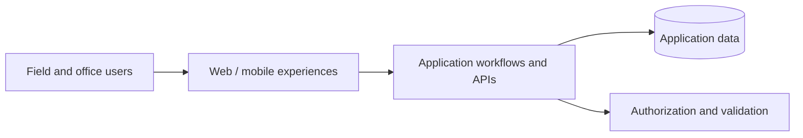

# OpsArmours — Project Showcase

**Domain:** Software for security operations and workforce workflows  
**Role:** Founder & Developer  
**Repository type:** Public portfolio documentation; **the application source code remains private**  
**Status:** Actively developed; individual features may be at different stages of completion

## The problem

Security operations can depend on fragmented spreadsheets, calls, and separate reporting tools. OpsArmours explores a more consistent way to coordinate assignments, site activity, reports, communication, and administrative review.

## Areas of work

- Plan role-based experiences for field workers, supervisors, managers, and administrators.
- Model workflows for shifts, attendance, incident reporting, patrol activity, and approvals.
- Design database-backed application flows, authentication, permissions, and API integration.
- Use Git, project documentation, and validation checks to improve maintainability.

## Technologies and engineering practices

The private project workspace uses a JavaScript/TypeScript web-oriented stack and documents development workflows around **Node.js, pnpm, GitHub Actions, linting, type checking, unit/integration tests, and application builds**. The broader product design includes **React, Next.js, PostgreSQL/Supabase, and API-driven features**. Technologies mentioned here describe project work and design; they do **not** imply every planned feature has shipped.

## Architecture at a glance

See [architecture notes](docs/architecture.md) and [engineering practices](docs/engineering.md).

## What can be reviewed publicly

This repository provides a high-level project overview and original explanatory documentation. It intentionally does not contain client records, internal configuration, business-sensitive workflows, tokens, proprietary source files, or screenshots of real operational data.

**Source access:** Private. Recruiters can review the separate, runnable [TaskFlow SQL API](https://github.com/opsarmour0-007/taskflow-sql-api) as a public code sample.
