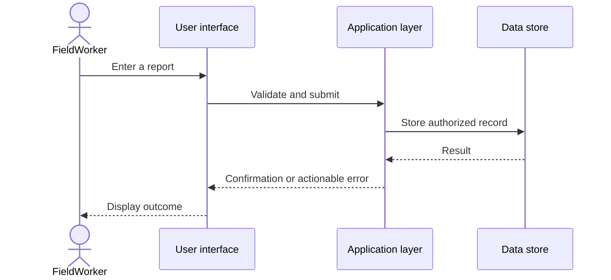

# Architecture notes (public, high level)

This page is a **conceptual view**, not a claim that all functionality is complete.

## Application concerns

1. **Presentation:** user-facing workflows for field and office roles.
2. **Application services:** actions such as submitting reports, receiving assignments, and requesting approvals.
3. **Data:** structured records, ownership, and relationships between organizations, users, and site activities.
4. **Access control:** permissions scoped to the user's organization and responsibility.
5. **Reliability:** clear validation, auditability, and design for intermittent field connectivity.

## Example feature journey

This illustrative sequence is not a representation of an exposed production endpoint.

## Engineering trade-offs

- Authorization must be enforced at the service and data boundaries, not merely hidden in the UI.
- Field input validation and recoverable errors matter for busy operational teams.
- Data isolation is foundational in software supporting multiple organizations.
- A feature is only considered ready when its implementation, validation, and intended behavior can be reviewed together.
